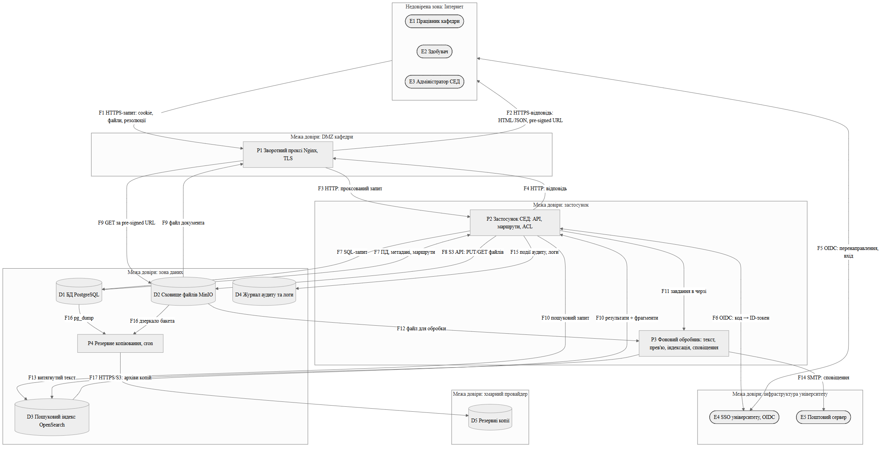

# Модель загроз: система електронного документообігу кафедри

**Варіант:** 14 (пріоритетна категорія STRIDE — розкриття інформації, Information disclosure)  ·  **Здобувач:** Скачков І. О.  ·  **Група:** ІП-34

> Система вигадана й навчальна; усі дані в цьому документі синтетичні.

## 1. Опис системи та активи

**Призначення.** Система електронного документообігу (СЕД) кафедри зберігає й веде маршрутами погодження внутрішні документи кафедри: заяви та подання здобувачів, проєкти наказів щодо здобувачів (переведення, відрахування, поновлення), екзаменаційні та залікові відомості, протоколи засідань кафедри, індивідуальні плани й кадрові документи викладачів, рецензії на кваліфікаційні роботи. Документ проходить маршрут «створення → погодження → підписання → публікація адресатам». Система має повнотекстовий пошук і надсилає сповіщення поштою.

**Користувачі** (зовнішні сутності):
- E1 — працівники кафедри: викладачі, секретар, завідувач (≈ 40 осіб); створюють, погоджують і підписують документи;
- E2 — здобувачі (≈ 600 осіб); подають заяви й отримують адресовані їм документи;
- E3 — адміністратор СЕД; керує обліковими записами, ролями й налаштуваннями.

**Зовнішні служби:** E4 — єдиний вхід університету (SSO, OpenID Connect), через який автентифікуються всі користувачі; E5 — поштовий сервер університету (SMTP); D5 — об'єктне сховище хмарного провайдера, куди щоночі вивантажуються резервні копії.

**Технічні припущення.** Застосунок (P2) працює за зворотним проксі Nginx (P1), що завершує TLS. Метадані, користувачі, ролі й маршрути зберігаються в PostgreSQL (D1), файли документів — у MinIO (D2), витягнутий текст документів — в індексі OpenSearch (D3). Фоновий обробник (P3) витягує текст, генерує прев'ю, індексує документи й розсилає сповіщення. Обсяг — близько 15 000 документів.

| ID | Актив | Тип | Цінність (К/Ц/Д) |
|----|-------|-----|------------------|
| A1 | Документи обмеженого доступу: накази щодо здобувачів, відомості, протоколи засідань, кадрові документи, рецензії | інформаційний (вміст документів) | В/В/С |
| A2 | Персональні дані здобувачів і працівників: ПІБ, контакти, оцінки, РНОКПП у кадрових документах | інформаційний (персональні дані) | В/В/С |
| A3 | Облікові записи, сесійні cookie, ID-токени SSO | автентифікаційні дані | В/В/С |
| A4 | Маршрути погодження, резолюції, позначки підписання документів | юридично значущі дані | С/В/С |
| A5 | Повнотекстовий пошуковий індекс (похідна копія вмісту A1) | інформаційний (похідний) | В/С/Н |
| A6 | Журнал аудиту та журнали застосунку | службові дані | С/С/Н |
| A7 | Секрети: пароль до БД, ключі доступу MinIO, клієнтський секрет OIDC, ключ підпису сесій | криптографічні/службові ключі | В/В/С |
| A8 | Резервні копії БД і сховища файлів | інформаційний (копія A1, A2) | В/В/С |
| A9 | Безперервність послуги (подання заяв і погодження наказів у встановлені строки) | послуга | Н/Н/С |

Шкала: В — висока, С — середня, Н — низька цінність за відповідною властивістю.

## 2. Діаграма потоків даних

Джерело діаграми — файл [`dfd.mmd`](dfd.mmd), зображення — [`dfd.png`](dfd.png).



Елементи діаграми:

| ID | Тип елемента DFD | Опис | Зона довіри |
|----|------------------|------|-------------|
| E1, E2, E3 | зовнішня сутність | працівник, здобувач, адміністратор (браузер) | недовірена (Інтернет) |
| E4 | зовнішня сутність | SSO університету (OIDC-провайдер) | інфраструктура університету |
| E5 | зовнішня сутність | поштовий сервер університету | інфраструктура університету |
| P1 | процес | зворотний проксі Nginx, завершення TLS | DMZ кафедри |
| P2 | процес | застосунок СЕД: REST API, маршрути погодження, перевірка прав (ACL) | застосунок |
| P3 | процес | фоновий обробник: витяг тексту, прев'ю, індексація, сповіщення | застосунок |
| P4 | процес | завдання резервного копіювання (cron) | зона даних |
| D1 | сховище | БД PostgreSQL: користувачі, ролі, метадані, маршрути | зона даних |
| D2 | сховище | MinIO: файли документів і прев'ю | зона даних |
| D3 | сховище | OpenSearch: повний текст документів для пошуку | зона даних |
| D4 | сховище | журнал аудиту та журнали застосунку | зона даних |
| D5 | сховище | резервні копії в хмарі | хмарний провайдер |

Потоки F1–F17 підписано на діаграмі. Межі довіри перетинають потоки F1/F2 (Інтернет → DMZ), F5/F6 (OIDC з інфраструктурою університету), F3/F4 і F9 (DMZ → застосунок і DMZ → зона даних), F7, F8, F10, F12, F13, F15 (застосунок ↔ зона даних), F14 (застосунок → пошта університету), F17 (зона даних → хмарний провайдер). Потік F9 (GET за pre-signed URL) — єдиний, що веде з DMZ одразу в зону даних, минаючи перевірку прав у P2.

## 3. Загрози за STRIDE

STRIDE застосовано за елементами (STRIDE-per-element): до зовнішніх сутностей — S, R; до процесів — усі шість категорій; до сховищ — T, I, D і R лише для журналу D4; до потоків — T, I, D.

| № | Елемент/потік | Категорія STRIDE | Опис загрози | Порушувана властивість |
|---|---------------|------------------|--------------|------------------------|
| T-01 | D3 (через P1) | I | REST API OpenSearch працює без автентифікації (security plugin вимкнено, «бо індекс внутрішній»), а в конфігурації P1 є `location /search-api/`, що проксіює запити до D3. Зовнішній зловмисник без облікового запису вивантажує повні тексти всіх проіндексованих документів (CWE-306, CWE-668) | конфіденційність |
| T-02 | P2 | I | IDOR: `GET /api/documents/{id}/file` перевіряє лише наявність сесії, але не право на конкретний документ; ідентифікатори послідовні. Будь-який здобувач перебором `id` завантажує чужі накази, відомості, кадрові документи (CWE-639) | конфіденційність |
| T-03 | P2 | I | Пошук фільтрує за ACL лише список результатів, але повертає загальну кількість збігів і фрагменти (highlight) недоступних документів. Запит «відрахування Прізвище» розкриває факт і зміст наказу (CWE-200, бічний канал) | конфіденційність |
| T-04 | D2 | I | Для швидкого прев'ю бакету `documents` у MinIO задано анонімну політику `download`, а S3-ендпойнт опубліковано через P1 для pre-signed URL. Ключі об'єктів передбачувані (`2026/{id}.pdf`), тож файли доступні без автентифікації (CWE-732) | конфіденційність |
| T-05 | F2 | I | Pre-signed URL мають строк дії 7 діб і потрапляють у листи, історію браузера, заголовок `Referer` під час переходу на зовнішні посилання з прев'ю, пересилаються між здобувачами — будь-хто з посиланням завантажує документ (CWE-598) | конфіденційність |
| T-06 | F14 | I | Лист-сповіщення містить тему, перші абзаци документа й вкладення; надсилається на особисті скриньки здобувачів, ретрансляція між MTA допускає відкат до нешифрованого SMTP (CWE-319) | конфіденційність |
| T-07 | F3/F4 | I | P1 завершує TLS, далі трафік до P2 іде відкритим HTTP у спільному VLAN з іншими серверами кафедри; зловмисник у суміжному сегменті перехоплює cookie сесій і вміст документів (CWE-319) | конфіденційність |
| T-08 | P2 | I | Увімкнений режим налагодження: сторінка помилки показує трасування стека, SQL-запит і змінні оточення, зокрема ключі MinIO та OpenSearch (CWE-209, CWE-215) | конфіденційність |
| T-09 | P3 | I | Під час публікації документ передається адресату як є: у DOCX лишаються автор, історія рецензування й видалені фрагменти, у PDF «зафарбовані» прямокутниками ПІБ залишаються текстовим шаром (CWE-212) | конфіденційність |
| T-10 | D4 | I | Журнали застосунку записують заголовки запитів (cookie сесій), коди OIDC і тіла запитів із ПІБ та текстом резолюцій; журнали читають адміністратори ОС і система моніторингу (CWE-532) | конфіденційність |
| T-11 | D5 | I | Резервні копії (дамп D1, дзеркало D2, знімки D3) вивантажуються в хмару незашифрованими; ключ доступу до бакета записано у cron-скрипті P4. Компрометація ключа або облікового запису провайдера розкриває всі дані (CWE-311) | конфіденційність |
| T-12 | D1 | I | Застосунок підключається до PostgreSQL як суперкористувач, пароль у відкритому вигляді зберігається в `.env` і в репозиторії розгортання; хто отримав доступ до репозиторію чи сервера, читає і змінює всю БД (CWE-250, CWE-798) | конфіденційність |
| T-13 | E1 | S | Збережений XSS у полі «коментар до погодження»: скрипт виконується в браузері завідувача, cookie сесії без `HttpOnly` відправляється зловмиснику, який далі діє від імені завідувача (CWE-79, CWE-1004) | автентичність |
| T-14 | E4 | S | P2 не перевіряє `aud` та `nonce` ID-токена: токен, виданий SSO іншому застосунку університету, яким керує зловмисник, приймається СЕД — вхід від імені користувача, що автентифікувався в тому застосунку (CWE-287) | автентичність |
| T-15 | D2 | T | Файл уже підписаного документа можна замінити в MinIO (версіонування вимкнено, хеш файлу не прив'язано до підпису в D1); інсайдер із доступом до сховища підмінює текст наказу (CWE-345) | цілісність |
| T-16 | P2 | T | CSRF: `POST /api/routes/{id}/approve` не має CSRF-токена, cookie має `SameSite=None`; працівник, відкривши сторонню сторінку, непомітно погоджує документ (CWE-352) | цілісність |
| T-17 | E1 | R | Погодження — проста кнопка без електронного підпису; у журналі лише `user_id` і час сервера. Працівник заперечує, що погоджував наказ (CWE-778) | неспростовність |
| T-18 | D4 | R | Журнал аудиту — звичайна таблиця в D1, адміністратор має права UPDATE/DELETE; перегляди й завантаження документів не журналюються зовсім, тож витік неможливо розслідувати (CWE-117, CWE-778) | неспростовність |
| T-19 | P3 | D | Завантаження «бомб» (DOCX як zip-бомба, PDF на тисячі сторінок) виснажує пам'ять і процесор обробника, черга прев'ю та сповіщень зупиняється (CWE-400, CWE-409) | доступність |
| T-20 | F1 | D | Масові запити в пікові періоди (завершення сесії, атестація) або важкі пошукові запити з шаблонами `*` перевантажують P1/P2 (CWE-770) | доступність |
| T-21 | P3 | E | Конвертер (LibreOffice headless, Ghostscript) обробляє файли користувачів з правами процесу, якому доступні ключі MinIO та OpenSearch; спеціально сформований документ дає виконання коду та вихід за межі обробника (CWE-94, CWE-250) | авторизація |
| T-22 | P2 | E | Роль «секретар» може призначати будь-які ролі, зокрема «завідувач»; немає матриці делегування, тож секретар надає собі чи іншим права підписання й доступ до кадрових документів (CWE-269) | авторизація |

Розподіл: I — 12, S — 2, T — 2, R — 2, D — 2, E — 2 (усього 22).

## 4. Оцінювання ризиків (CVSS / матриця)

Оцінки обчислено файлом [`../lab01_threat_model/scoring.py`](../lab01_threat_model/scoring.py) з калькулятором `cvss.py`. **Жирним** виділено загрози високого ризику (CVSS ≥ 7,0). Імовірність оцінено експертно (Н/С/В) з урахуванням поширеності помилки та кола потенційних порушників, вплив — за цінністю зачепленого активу. Ранг — порядок за базовою оцінкою (за рівних оцінок — за добутком «ймовірність × вплив»); після тире — рівень за матрицею 3×3 (добуток балів Н=1, С=2, В=3: 6–9 — високий, 3–4 — середній, 1–2 — низький).

| № загрози | Вектор CVSS | Базова оцінка | Імовірність | Вплив | Ранг ризику |
|-----------|-------------|---------------|-------------|-------|-------------|
| T-01 | `CVSS:3.1/AV:N/AC:L/PR:N/UI:N/S:U/C:H/I:L/A:L` | **8.6** (високий) | В | В | 1 — високий |
| T-02 | `CVSS:3.1/AV:N/AC:L/PR:L/UI:N/S:U/C:H/I:N/A:N` | 6.5 (середній) | В | В | 6 — високий |
| T-03 | `CVSS:3.1/AV:N/AC:L/PR:L/UI:N/S:U/C:L/I:N/A:N` | 4.3 (середній) | С | С | 20 — середній |
| T-04 | `CVSS:3.1/AV:N/AC:L/PR:N/UI:N/S:U/C:H/I:N/A:N` | **7.5** (високий) | С | В | 4 — високий |
| T-05 | `CVSS:3.1/AV:N/AC:H/PR:N/UI:R/S:U/C:H/I:N/A:N` | 5.3 (середній) | С | С | 14 — середній |
| T-06 | `CVSS:3.1/AV:N/AC:H/PR:N/UI:N/S:U/C:H/I:N/A:N` | 5.9 (середній) | С | С | 11 — середній |
| T-07 | `CVSS:3.1/AV:A/AC:H/PR:N/UI:N/S:U/C:H/I:L/A:N` | 5.9 (середній) | Н | В | 12 — середній |
| T-08 | `CVSS:3.1/AV:N/AC:L/PR:N/UI:N/S:U/C:L/I:N/A:N` | 5.3 (середній) | В | Н | 15 — середній |
| T-09 | `CVSS:3.1/AV:N/AC:L/PR:L/UI:N/S:U/C:L/I:N/A:N` | 4.3 (середній) | С | С | 21 — середній |
| T-10 | `CVSS:3.1/AV:L/AC:L/PR:H/UI:N/S:U/C:H/I:N/A:N` | 4.4 (середній) | Н | С | 19 — низький |
| T-11 | `CVSS:3.1/AV:N/AC:H/PR:N/UI:N/S:U/C:H/I:N/A:N` | 5.9 (середній) | Н | В | 13 — середній |
| T-12 | `CVSS:3.1/AV:A/AC:H/PR:L/UI:N/S:U/C:H/I:H/A:N` | 6.4 (середній) | Н | В | 10 — середній |
| T-13 | `CVSS:3.1/AV:N/AC:L/PR:L/UI:R/S:C/C:H/I:L/A:N` | **7.6** (високий) | С | В | 3 — високий |
| T-14 | `CVSS:3.1/AV:N/AC:H/PR:N/UI:R/S:U/C:H/I:H/A:N` | 6.8 (середній) | Н | В | 5 — середній |
| T-15 | `CVSS:3.1/AV:N/AC:L/PR:H/UI:N/S:U/C:N/I:H/A:N` | 4.9 (середній) | Н | В | 17 — середній |
| T-16 | `CVSS:3.1/AV:N/AC:L/PR:N/UI:R/S:U/C:N/I:H/A:N` | 6.5 (середній) | С | С | 7 — середній |
| T-17 | `CVSS:3.1/AV:N/AC:L/PR:L/UI:N/S:U/C:N/I:L/A:N` | 4.3 (середній) | С | С | 22 — середній |
| T-18 | `CVSS:3.1/AV:N/AC:L/PR:H/UI:N/S:U/C:N/I:H/A:N` | 4.9 (середній) | Н | С | 18 — низький |
| T-19 | `CVSS:3.1/AV:N/AC:L/PR:L/UI:N/S:U/C:N/I:N/A:H` | 6.5 (середній) | С | С | 8 — середній |
| T-20 | `CVSS:3.1/AV:N/AC:L/PR:N/UI:N/S:U/C:N/I:N/A:L` | 5.3 (середній) | С | Н | 16 — низький |
| T-21 | `CVSS:3.1/AV:N/AC:H/PR:L/UI:N/S:C/C:H/I:H/A:H` | **8.5** (високий) | С | В | 2 — високий |
| T-22 | `CVSS:3.1/AV:N/AC:L/PR:H/UI:N/S:U/C:H/I:H/A:N` | 6.5 (середній) | Н | В | 9 — середній |

Загрози високого ризику: T-01 (8.6), T-21 (8.5), T-13 (7.6), T-04 (7.5). Окремо: T-02 має середню оцінку CVSS (6.5), але за матрицею — високий ризик (ймовірність В, вплив В), тому в реєстрі її опрацьовано разом із високими.

Обґрунтування неочевидних метрик:
- T-01 — I:L/A:L, а не H: відкритий API дає змогу змінити чи видалити індекс, але індекс похідний (його можна перебудувати з D2), тож страждає лише пошук.
- T-13 — S:C: вразливе поле міститься у P2, а скрипт виконується в браузері іншого користувача (інша область повноважень); I:L, бо для підписання потрібне повторне підтвердження.
- T-21 — S:C: вразливий конвертер у P3, а наслідки (ключі MinIO та OpenSearch) поширюються на сховища зони даних; AC:H, бо експлойт залежить від конкретної версії конвертера.
- T-12 — AV:A: викраденим паролем можна скористатися лише з внутрішньої мережі, де доступний порт PostgreSQL.

## 5. Реєстр ризиків і рішення

Залишковий ризик обчислено тим самим калькулятором для вектора після впровадження контрзаходу (стовпець `residual` у `scoring.py`).

| № | Ризик | Рішення (усунути/зменшити/передати/прийняти) | Контрзахід | Залишковий ризик |
|---|-------|----------------------------------------------|------------|------------------|
| T-01 | Масовий витік текстів документів з D3 | усунути | Увімкнути security plugin OpenSearch (автентифікація, TLS, ролі тільки для P2/P3); прибрати `location /search-api/` з P1; мережеве правило «D3 приймає з'єднання лише від P2 і P3»; для документів із грифом обмеженого доступу індексувати лише метадані | 2.0 (низький) |
| T-02 | IDOR під час завантаження файлів | зменшити | Централізована перевірка права на об'єкт у кожному обробнику (policy enforcement point), ідентифікатори UUIDv4, автотести авторизації для кожного маршруту, журналювання завантажень | 3.1 (низький) |
| T-03 | Фрагменти недоступних документів у пошуку | зменшити | ACL-фільтр у самому запиті до D3 (document-level security), а не після нього; без highlight і лічильника для недоступних документів | 3.1 (низький) |
| T-04 | Анонімний доступ до бакета MinIO | усунути | Прибрати анонімну політику, заборонити публічні політики бакета; S3-ендпойнт не публікувати через P1, видавати файли через P2 після перевірки прав | 2.2 (низький) |
| T-05 | Витік pre-signed URL | зменшити | Строк дії посилання — 5 хв, одноразове завантаження через P2, `Referrer-Policy: no-referrer`, у листах — лише посилання на картку документа в СЕД | 3.1 (низький) |
| T-06 | Вміст документів у листах | зменшити | Лист містить лише назву й посилання на СЕД без вкладень і фрагментів; MTA-STS / обов'язковий STARTTLS; надсилання тільки на корпоративні скриньки | 3.7 (низький) |
| T-07 | Перехоплення трафіку P1↔P2 | зменшити | TLS (mTLS) між P1 і P2, окремий VLAN для СЕД | 2.0 (низький) |
| T-08 | Детальні помилки | усунути | Вимкнути режим налагодження у production, типова сторінка помилки з ідентифікатором кореляції, деталі — лише в журнал | 3.7 (низький) |
| T-09 | Приховані дані в опублікованих файлах | зменшити | Під час публікації — очищення метаданих (mat2 / exiftool), прийняття всіх виправлень, справжнє редагування PDF (видалення текстового шару) | 3.1 (низький) |
| T-10 | Секрети й ПД у журналах | зменшити | Маскування cookie, токенів, кодів OIDC і ПД у логері; доступ до журналів за ролями, строк зберігання 90 днів | 1.9 (низький) |
| T-11 | Нешифровані резервні копії у хмарі | передати | Договір із провайдером (SLA, відповідальність за інциденти, розміщення даних) + шифрування копій на боці кафедри (age/GPG) до вивантаження, ключ — окремо від копій, MFA для облікового запису провайдера | 2.2 (низький) |
| T-12 | Суперкористувач БД, пароль у `.env` | зменшити | Окремий обліковий запис з мінімальними правами (без DDL, без доступу до D4), секрети — у сховищі секретів, ротація пароля, видалення пароля з історії репозиторію | 3.1 (низький) |
| T-13 | Викрадення сесії завідувача через XSS | зменшити | Контекстне кодування виводу, Content-Security-Policy без `unsafe-inline`, cookie `HttpOnly; Secure; SameSite=Lax`, повторне підтвердження для підписання | 3.7 (низький) |
| T-14 | Підстановка ID-токена SSO | усунути | Перевірка підпису, `iss`, `aud`, `exp`, `nonce` і `state` сертифікованою бібліотекою OIDC; PKCE | 3.1 (низький) |
| T-15 | Заміна файлу підписаного документа | зменшити | SHA-256 файлу зберігається в D1 разом із підписом і перевіряється під час видачі; версіонування та Object Lock у MinIO | 2.2 (низький) |
| T-16 | CSRF на погодження | усунути | CSRF-токен для всіх змінювальних запитів, `SameSite=Lax`, перевірка `Origin` | 3.1 (низький) |
| T-17 | Заперечення погодження | зменшити | Погодження й підписання кваліфікованим електронним підписом над хешем документа з міткою часу від надавача довірчих послуг | 3.1 (низький) |
| T-18 | Редагування журналу аудиту | зменшити | Журнал аудиту лише на дописування (окремий сервіс, хеш-ланцюжок записів), журналювання переглядів і завантажень документів, копія журналу на окремий вузол | 1.9 (низький) |
| T-19 | Файли-«бомби» в обробнику | зменшити | Обмеження розміру файлу й кількості сторінок, тайм-аут і ліміти cgroups для конвертера, окрема черга для великих файлів | 4.3 (середній) |
| T-20 | Перевантаження запитами | прийняти | Залишається наявне базове обмеження частоти запитів (`limit_req` у Nginx). Обґрунтування — нижче | 5.3 (середній) |
| T-21 | Виконання коду в конвертері | зменшити | Конвертер в окремому контейнері без мережі й без секретів (seccomp, read-only FS, непривілейований користувач), отримує файл і повертає результат через чергу; регулярне оновлення конвертера | 5.0 (середній) |
| T-22 | Призначення ролей секретарем | усунути | Матриця делегування: секретар може призначати лише ролі «викладач» і «здобувач»; роль «завідувач» — лише адміністратор за підтвердженням другої особи | 3.3 (низький) |

**Обґрунтування прийнятого ризику T-20.** Система обслуговує близько 640 користувачів, а наслідок атаки — тимчасова недоступність без втрати чи розкриття даних (C:N, I:N, A:L). Строки подання заяв визначаються наказом і можуть бути продовжені, тож кілька годин простою не створюють юридичних наслідків. Комерційний захист від DDoS коштує більше, ніж очікувані збитки, а від мережевих атак рівня каналу кафедру вже захищає мережа університету. Тому ризик прийнято з наявним `limit_req`; залишковий ризик дорівнює вихідному (5.3).

**Покриття гілок дерева атак (розділ 6) контрзаходами:**

| Гілка дерева | Контрзахід, що її перекриває | Загрози реєстру |
|--------------|-----------------------------|-----------------|
| 1 — прямий доступ до REST API | автентифікація і TLS в OpenSearch, видалення `location` з P1, мережеве правило | T-01 |
| 2 — збирання фрагментів через пошук | ACL-фільтр у запиті до індексу, без highlight для недоступних | T-03 |
| 3 — знімок індексу | шифрування резервних копій, ключ у сховищі секретів; API `_snapshot` лише для ролі адміністратора | T-11, T-01 |
| 4 — викрадені облікові дані | вимкнений режим налагодження, ізоляція конвертера без секретів, сховище секретів | T-08, T-21, T-12 |
| **усі гілки 1–4** | **мінімізація індексу: для документів обмеженого доступу в D3 потрапляють лише метадані (назва, номер, дата), повний текст — ні** | T-01, T-03, T-11 |

## 6. Дерево атак для найкритичнішої загрози

Найкритичніша загроза — **T-01** (CVSS 8.6). Корінь дерева — її мета. Джерело — [`attack_tree.mmd`](attack_tree.mmd), зображення — [`attack_tree.png`](attack_tree.png).

```
Мета (T-01): отримати повні тексти документів обмеженого доступу з індексу D3
  OR
  ├── 1. Прямий доступ до REST API OpenSearch
  │     AND
  │     ├── 1.1 Знайти доступний ендпойнт
  │     │     OR
  │     │     ├── 1.1.1 Просканувати IP-адресу кафедри на порт 9200/TCP
  │     │     └── 1.1.2 Знайти в JS-бандлі шлях /search-api/, що P1 веде до D3
  │     ├── 1.2 GET /_cat/indices без облікових даних (security plugin вимкнено)
  │     └── 1.3 Вивантажити індекс docs: _search?scroll=5m&size=10000
  ├── 2. Зібрати фрагменти через пошук застосунку P2 (T-03)
  │     AND
  │     ├── 2.1 Увійти через SSO обліковим записом будь-якого здобувача
  │     ├── 2.2 Шукати «наказ відрахування», ПІБ, номери наказів з highlight
  │     └── 2.3 Склеїти фрагменти, до яких ACL не застосовано
  ├── 3. Отримати знімок індексу (T-11)
  │     OR
  │     ├── 3.1 Завантажити snapshot із D5 ключем, викраденим із cron-скрипта P4
  │     └── 3.2 Через відкритий API створити власний _snapshot-репозиторій
  └── 4. Підключитися до D3 з викраденими обліковими даними
        AND
        ├── 4.1 Отримати облікові дані OpenSearch
        │     OR
        │     ├── 4.1.1 Прочитати змінні оточення на сторінці помилки (T-08)
        │     └── 4.1.2 Виконати код у P3 шкідливим DOCX (T-21), прочитати .env
        └── 4.2 Надіслати запити до D3 зі скомпрометованого внутрішнього вузла
```

**Найдешевший шлях для порушника** — гілка 1 через 1.1.2: шлях до API видно в коді фронтенду, обліковий запис не потрібен, достатньо трьох HTTP-запитів. Гілка 2 потребує облікового запису і дає лише фрагменти; гілки 3 і 4 потребують попередньої компрометації інших компонентів (ключа копій, режиму налагодження чи конвертера). Відповідні шаблони атак CAPEC: CAPEC-87 (Forceful Browsing) для 1.1.2, CAPEC-300 (Port Scanning) для 1.1.1, CAPEC-54 (Query System for Information) для гілки 2.

## 7. Висновки

1. Для СЕД кафедри домінує пріоритетна категорія варіанта — розкриття інформації: 12 з 22 загроз (55 %), утричі більше, ніж будь-яка інша категорія (по 2). Головний актив системи — вміст документів обмеженого доступу (A1, К = В), і він має щонайменше п'ять копій: D2 (оригінали), D3 (текст у пошуковому індексі), D5 (резервні копії), листи E5 і журнали D4. Кожна копія — окремий канал витоку.
2. Найкритичніша загроза — T-01 (CVSS 8.6): відкритий API пошукового індексу. Вона поєднує максимальну експлуатованість (AV:N, AC:L, PR:N, UI:N — підоцінка 3.89, найбільше можливе значення) із високим впливом на конфіденційність похідного активу A5, що містить повний текст усіх документів. Її оцінка вища, ніж у T-04 (7.5), через додатковий вплив I:L/A:L, і вища, ніж у T-02 (6.5), бо не потрібна автентифікація (PR:N замість PR:L дає +1.0 бала).
3. Чотири загрози мають високий ризик за CVSS (T-01, T-21, T-13, T-04), ще одна (T-02) — за матрицею «ймовірність × вплив». Середня базова оцінка після впровадження контрзаходів знижується з 6.00 до 3.10.
4. Найбільший ефект за найменших витрат дають:
   - мінімізація пошукового індексу (повний текст документів обмеженого доступу не індексувати) — одна зміна в P3 перекриває всі чотири гілки дерева атак і загрози T-01, T-03, T-11;
   - автентифікація й шифрування на всіх внутрішніх з'єднаннях (OpenSearch, MinIO, P1↔P2) із мережевими правилами «лише від P2/P3» — перекриває T-01, T-04, T-07 і обмежує наслідки T-12, T-21;
   - централізована перевірка прав на об'єкт у P2 — перекриває T-02, T-03, T-05 (видача файлів через P2), T-22.
5. Першочергово слід усунути T-01, T-04 і T-08 (налаштування, без розробки), потім T-02/T-03 (зміни коду авторизації) і T-21 (ізоляція конвертера). Ризик T-20 прийнято, ризик T-11 передано провайдеру з додатковим шифруванням.
